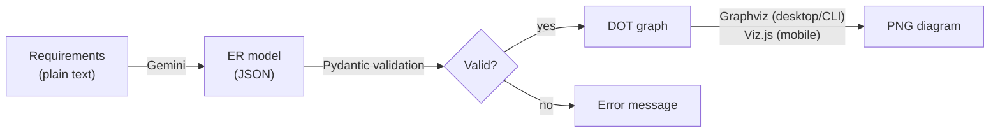

<h1 align="center">ER Tools</h1>

<p align="center"> Turn plain-language requirements into ER models, and ER models into diagrams. </p>

<div align="center">

[Features](#features) · [Quick start](#quick-start) · [Model format](#er-model-json-format) · [Project structure](#project-structure)

</div>

## Table of Contents

- [Overview](#overview)
- [Features](#features)
- [Requirements](#requirements)
- [Quick start](#quick-start)
  - [Install](#install)
  - [Run the app](#run-the-app)
  - [Command-line usage](#command-line-usage)
- [ER model JSON format](#er-model-json-format)
  - [Example](#example)
  - [Field reference](#field-reference)
  - [Validation rules](#validation-rules)
  - [Diagram notation](#diagram-notation)
- [How it works](#how-it-works)
- [Project structure](#project-structure)
- [Building](#building)
- [Tech stack](#tech-stack)

---

## Overview

ER Tools is a cross-platform [Flet](https://flet.dev) app (desktop, Android, iOS) with two command-line companions. It does two things:

| Tool | Input | Output |
|  --- | --- | --- |
|  **Generate Diagram** | ER model JSON | ER diagram PNG |
|  **Generate Model** | High-level requirement description | ER model JSON |

Chain them together to go from "a library where members borrow books" to a finished diagram.

## Features

- **Chen-notation diagrams** with entities, weak entities, relationships, identifying relationships, and attributes of every kind.
- **Cardinality and participation** on every relationship edge, with optional roles.
- **Rich attribute support**: primary keys, partial keys, multivalued, derived, and composite attributes.
- **Strict validation** with Pydantic, so malformed models fail with clear messages before anything is drawn.
- **Interactive viewer** with pan, pinch/scroll zoom, and save-to-PNG.
- **AI model generation** with Gemini, constrained to the same JSON schema the renderer uses.

## Requirements

| Requirement | Needed for | Notes |
| --- | --- | --- |
| Python 3.12+ | Everything | |
| [uv](https://docs.astral.sh/uv/) | Everything | Manages the environment and dependencies |
| [Graphviz](https://graphviz.org/download/) binaries | Diagrams on desktop and CLI | `neato` must be on your `PATH` |
| [Gemini API key](https://aistudio.google.com/apikey) | Model generation | Optional if you only render diagrams |

## Quick start

### Install

```bash
git clone https://github.com/TarekSaeed0/er-tools
cd er-tools
uv sync
```

### Run the app

```bash
uv run flet run
```

| Tab | What it does |
| --- | --- |
| **Generate Diagram** | Pick an ER model JSON file, render it, zoom and pan the result, then save it as PNG. |
| **Generate Model** | Describe a system in natural language and get back ER model JSON you can save. Needs a Gemini API key. |
| **Settings** | Choose the theme and store your Gemini API key. |

### Command-line usage

First install 

**JSON → PNG** (output defaults to `<input>.png`):

```bash
generate-diagram model.json -o diagram.png
```

**Description → JSON:**

```bash
export GEMINI_API_KEY=your-key

generate-model \
  "A library system where members borrow books." -o model.json
```

You can pass `--api-key` instead of setting `GEMINI_API_KEY`.

## ER model JSON format

### Example

<details open>
<summary><b>A small library model</b></summary>

```json
{
  "entities": [
    {
      "name": "Member",
      "attributes": [
        { "name": "member_id", "is_primary_key": true },
        {
          "name": "name",
          "sub_attributes": [{ "name": "first" }, { "name": "last" }]
        },
        { "name": "phone", "is_multivalued": true }
      ]
    },
    {
      "name": "Book",
      "attributes": [
        { "name": "isbn", "is_primary_key": true },
        { "name": "title" }
      ]
    }
  ],
  "relationships": [
    {
      "name": "Borrows",
      "participations": [
        { "entity_name": "Member", "cardinality": "many", "constraint": "partial" },
        { "entity_name": "Book", "cardinality": "many", "constraint": "partial" }
      ],
      "attributes": [{ "name": "due_date" }]
    }
  ]
}
```

</details>

### Field reference

| Object | Field | Type | Default | Notes |
| --- | --- | --- | --- | --- |
| **Model** | `entities` | list of Entity | | |
| | `relationships` | list of Relationship | | |
| **Entity** | `name` | string | | Unique, non-empty |
| | `is_weak` | bool | `false` | |
| | `attributes` | list of Attribute | | At least one |
| **Relationship** | `name` | string | | Non-empty |
| | `is_identifying` | bool | `false` | |
| | `participations` | list of Participation | | At least two |
| | `attributes` | list of Attribute | `[]` | |
| **Participation** | `entity_name` | string | | Must match an existing entity |
| | `role` | string or null | `null` | Unique within a relationship |
| | `cardinality` | `"one"` \| `"many"` | `"many"` | |
| | `constraint` | `"partial"` \| `"total"` | `"partial"` | |
| **Attribute** | `name` | string | | Non-empty, unique among siblings |
| | `is_primary_key` | bool | `false` | |
| | `is_partial_key` | bool | `false` | |
| | `is_multivalued` | bool | `false` | |
| | `is_derived` | bool | `false` | |
| | `sub_attributes` | list of Attribute | `[]` | Makes the attribute composite |

### Validation rules

<details>
<summary><b>Show all rules</b></summary>

**Uniqueness**
- Entity names are unique within a model.
- Attribute names are unique within an entity or relationship.
- Sub-attribute names are unique within their parent attribute.
- Participation roles are unique within a relationship.

**Keys**
- A strong entity must have a primary key and no partial key.
- A weak entity must have a partial key and no primary key.
- An attribute can't be both a primary key and a partial key.
- Multivalued attributes can't be keys.

**Relationships**
- Participations may only reference existing entities.
- An identifying relationship must involve at least one weak entity.
- Every weak entity must depend, directly or indirectly, on a strong entity through identifying relationships with total participation.

</details>

### Diagram notation

| Element | Rendered as |
| --- | --- |
| Entity | Rectangle |
| Weak entity | Double rectangle |
| Relationship | Diamond |
| Identifying relationship | Double diamond |
| Attribute | Ellipse |
| Primary key | Underlined name |
| Partial key | Dashed underlined name |
| Multivalued attribute | Double ellipse |
| Derived attribute | Dashed ellipse |
| Composite attribute | Ellipse with sub-attributes attached |
| Partial participation | Single line |
| Total participation | Double line |
| Cardinality | `1` for one; `N`, `M`, `P`, ... for each many side |

## How it works



Both renderers build the same DOT graph (`neato` layout), so diagrams look consistent across platforms. Only the final rasterization step differs.

## Project structure

```
er-tools/
├── pyproject.toml
└── src/
    ├── main.py                        # Flet entry point and navigation
    ├── models.py                      # Pydantic ER model and validation rules
    ├── utils.py                       # Asset path and error snackbar helpers
    ├── assets/
    │   └── viz.js                     # Viz.js, used for mobile rendering
    ├── contexts/
    │   └── settings_context.py        # Theme and API key settings
    ├── screens/
    │   ├── generate_diagram_screen.py
    │   ├── generate_model_screen.py
    │   └── settings_screen.py
    ├── services/
    │   ├── diagram_renderer.py        # Graphviz and Viz.js WebView renderers
    │   └── model_generator.py         # Gemini-backed model generator
    └── scripts/
        ├── generate_diagram.py        # CLI: JSON -> PNG
        └── generate_model.py          # CLI: description -> JSON
```

## Building

To build an Android APK:

```bash
uv run flet build apk
```

See the [Flet publishing docs](https://flet.dev/docs/publish) for other targets.

## Tech stack

[Flet](https://flet.dev) · [Pydantic](https://docs.pydantic.dev) · [Graphviz](https://graphviz.org) · [Viz.js](https://github.com/mdaines/viz-js) · [Google Gen AI SDK](https://github.com/googleapis/python-genai)
